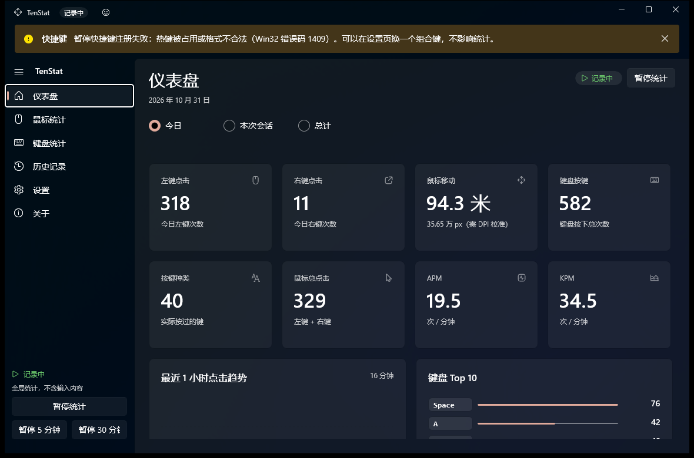
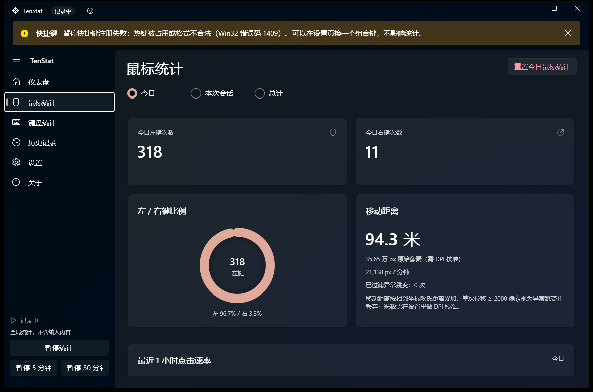
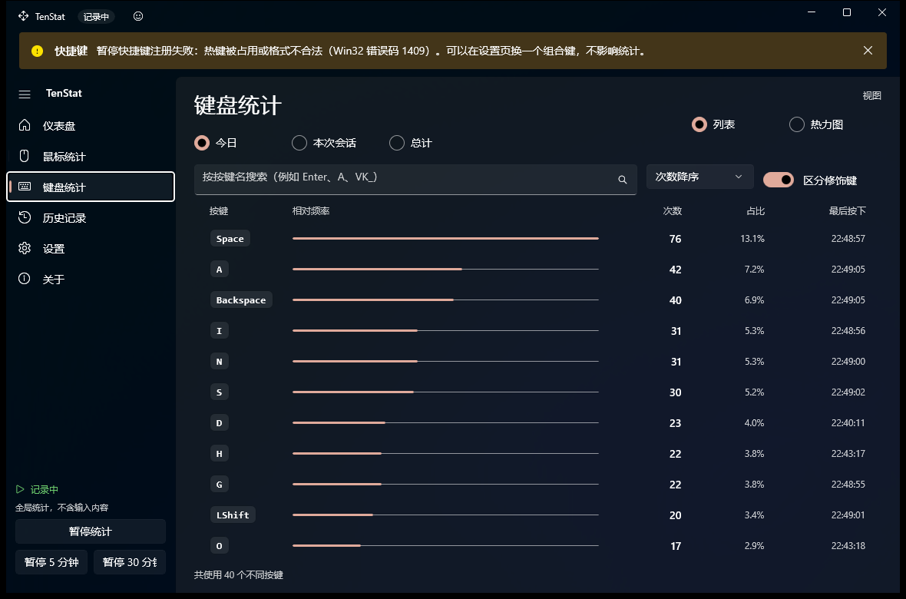
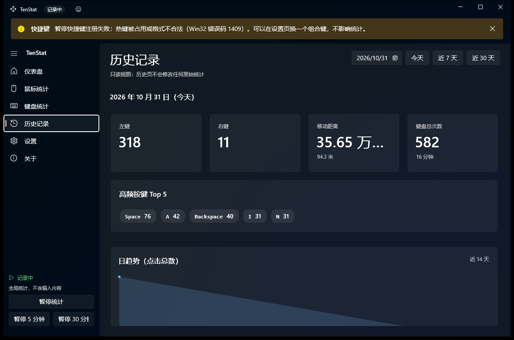
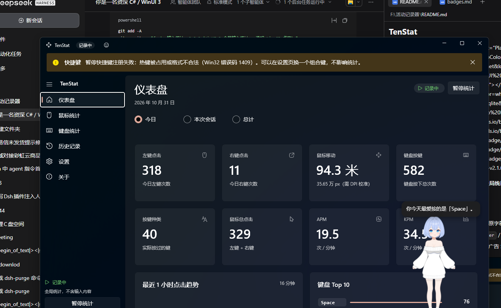

<h1 align="center">TenStat</h1>

<p align="center">
  <a href="#"></a>
  <a href="#"></a>
  <a href="#"></a>
  <a href="#"></a>
  <a href="#"></a>
  <a href="#"></a>
</p>

<p align="center">
  <a href="#"></a>
  <a href="#"></a>
  <a href="#"></a>
  <a href="#"></a>
  <a href="#"></a>
  <a href="#"></a>
</p>

一个常驻后台的 Windows 桌面小工具：**全局统计鼠标左右键点击、鼠标移动距离、每个按键被按了多少次**，数据全部存在本机 SQLite 里，完全离线。

> **隐私承诺（写进代码里的三条）**
> 1. 不记录输入内容：不保存文字、不还原字符、不截屏、不记录鼠标轨迹明细；
> 2. 按键只存虚拟键码与名称（`A` / `Enter` / `VK_6A`），不区分大小写；
> 3. 不联网、不上传、不内嵌任何统计或广告 SDK。



---

## 1. 功能一览

| 能力 | 说明 |
| --- | --- |
| 鼠标 | 左键 / 右键次数、移动距离（**米为主、像素为辅**）、移动速度、左/右键比例、单次位移 ≥ 2000px 的异常跳变过滤并计数 |
| 键盘 | 每个**实际按过**的键的次数、占比、最后按下时间；没按过的键不创建、不显示；未知键显示 `VK_xx`；默认过滤长按重复（可开关） |
| 统计口径 | 今日 / 本次会话 / 历史总计，切换只影响展示，后台一直累加 |
| 实时性 | 钩子回调只做计数，UI 每 600ms 拉一次快照；每 100 次事件或每 15 秒批量落盘 |
| 暂停 | 界面按钮、托盘菜单、全局快捷键（默认 `Ctrl+Alt+P`）、暂停 5 分钟 / 30 分钟（带倒计时自动恢复） |
| 排除应用 | 前台窗口命中**你配置的**排除列表时不统计；默认**不排除自己**——在本程序里点击、敲键也照常计数 |
| 数据 | 自动保存、崩溃后 WAL 自恢复、导出 CSV / JSON、清空今日 / 全部（均二次确认）、数据目录一键打开 |
| 发布 | `publish.ps1` 一键产出 `dist\TenStat.exe`（绿色目录，双击即用）和 `TenStat-win-x64.zip` |
| 常驻 | 关闭窗口最小化到托盘，托盘菜单：显示主界面 / 暂停恢复 / 导出今天 / 打开数据文件夹 / 退出；可选开机自启（`--tray` 静默启动） |
| 桌宠 | 可选 Live2D 桌宠：**逐像素透明**、可自由拖动、滚轮缩放、点一下会说话（台词按今天的统计生成）；同一个进程，见第 7 节 |

界面：WinUI 3 + Fluent 2，Mica 背景，跟随系统深浅色（可手动切换），中英文数字混排，卡片栅格随窗口宽度自适应 2/3/4 列。

<table>
<tr>
<td></td>
<td></td>
</tr>
<tr>
<td></td>
<td></td>
</tr>
</table>

---

## 2. 快速开始

### 2.1 环境要求

- Windows 10 1809+ / Windows 11
- .NET SDK 8.0（运行时 8.0.x）
- **Visual Studio 2022**（构建 WinUI 3 需要它的 MSBuild，见下方说明）
- WebView2 Runtime（Win10/11 一般自带；桌宠面板需要）
- 可选：一个 Live2D 模型目录（`.model3.json` + `.moc3` + 贴图）

### 2.2 构建

```powershell
# 一把梭（推荐）：构建 + 启动
powershell -ExecutionPolicy Bypass -File build.ps1 -Configuration Release -Run

# 只构建
powershell -ExecutionPolicy Bypass -File build.ps1 -Configuration Release

# 手动（等价）
& "D:\c\MSBuild\Current\Bin\MSBuild.exe" src\TenStat\TenStat.csproj `
    -restore -p:Configuration=Release -p:Platform=x64
```

要发给别人时用打包脚本（会清空并重建 `dist\`）：

```powershell
powershell -ExecutionPolicy Bypass -File publish.ps1 -Zip
# → dist\TenStat.exe（双击就能跑）、dist\使用说明.txt、根目录 TenStat-win-x64.zip
```

> ⚠️ **为什么主程序不能用 `dotnet build`**
> WinUI 3 的资源（PRI）生成需要 `Microsoft.Build.Packaging.Pri.Tasks.dll`，这个程序集只随 Visual Studio 安装，dotnet SDK 里没有。用 `dotnet build` 会报
> `MSB4062: 未能加载任务 ExpandPriContent`。`build.ps1` 会自动用 vswhere 找到 VS 的 `MSBuild.exe`。
> 桌宠是主窗口里的 WebView2 面板，不再有独立的 `Live2DPet.exe`；`tools/DbTool` 用 `dotnet build` 也没问题。

### 2.3 运行

```
dist\TenStat.exe          ← publish.ps1 产出的干净目录，直接分享这个文件夹
```

- 非打包（unpackaged）运行，**自带 Windows App SDK 运行时**（`WindowsAppSDKSelfContained=true`），不需要装 MSIX、不需要证书、不需要管理员权限；
- 桌宠是主窗口旁边的透明浮层（同进程），标题栏笑脸图标可收起/展开，设置页可调大小与模型目录；
- 首次启动弹「隐私说明」对话框，点「同意并开始统计」之后钩子才开始工作。

### 2.4 数据在哪

```
%LocalAppData%\TenStat\
├─ stats.db            主数据库（WAL 模式）
├─ app.log             运行日志（只记程序事件，不含输入内容）
├─ exports\            导出的 CSV / JSON
└─ WebView2\           内嵌桌宠的 WebView2 用户数据目录
```

---

## 3. 目录结构

```
活动记录器/
├─ TenStat.sln
├─ build.ps1                      一键构建（自动找 VS MSBuild）
├─ publish.ps1                    打包成 dist\（绿色目录）与 zip
├─ README.md
├─ dist/                          「TenStat.exe」+ 运行时（分享这个目录）
├─ docs/
│  ├─ architecture.md             分层、线程模型、落盘策略、踩坑记录
│  ├─ acceptance.md               逐条验收记录（含实测证据）
│  ├─ schema.sql                  建表语句 + 关键 SQL
│  ├─ badges.md                   徽章源码 + 上传 GitHub 清单
│  └─ images/                     界面截图
├─ src/
│  ├─ TenStat/         主程序（WinUI 3）
│  │  ├─ App.xaml(.cs)            进程入口，先建数据层再建窗口
│  │  ├─ MainWindow.xaml(.cs)     NavigationView + Frame + 全局 InfoBar + 托盘/热键/隐私对话框
│  │  ├─ Themes/Styles.xaml       设计令牌：圆角/间距/颜色语义/卡片与徽章样式
│  │  ├─ Models/                  DailyStat / KeyStat / SessionStat / ExcludedApp / StatScope
│  │  ├─ Services/
│  │  │  ├─ MouseHookService.cs        WH_MOUSE_LL
│  │  │  ├─ KeyboardHookService.cs     WH_KEYBOARD_LL（只管 vkCode，不取字符）
│  │  │  ├─ StatsService.cs            汇总/暂停/排除/活跃时长/趋势/落盘
│  │  │  ├─ StorageService.cs          SQLite 全部读写 + 自愈
│  │  │  ├─ SettingsService.cs         AppSettings 强类型包装
│  │  │  ├─ ExclusionService.cs        前台进程名匹配
│  │  │  ├─ TrayIcon.cs                Shell_NotifyIcon + RegisterHotKey（自己实现）
│  │  │  ├─ ExportService.cs           CSV / JSON
│  │  │  ├─ Live2DPetService.cs        桌宠：模型目录 / WebView2 环境
│  │  │  ├─ PetDialogue.cs             按今日统计生成桌宠台词
│  │  │  ├─ ModelSettingsBuilder.cs    运行时合成带 Motions/Expressions 的 model3.json
│  │  │  ├─ StartupService.cs          开机自启（HKCU Run）
│  │  │  ├─ AppServices.cs             极简服务定位器
│  │  │  └─ AppLog.cs                  本地日志
│  │  ├─ ViewModels/              Shell + 5 个页面 VM + PageViewModelBase
│  │  ├─ Views/                   DashboardPage / MousePage / KeyboardPage / HistoryPage / SettingsPage / AboutPage
│  │  ├─ Controls/                MiniLineChart / DonutRing / PetOverlay（透明桌宠浮层）/ CompositionInterop
│  │  ├─ Assets/Live2D/           桌宠页面：pet.html/css/js + vendor（pixi / cubism core / pixi-live2d-display）
│  │  └─ Helpers/                 NativeMethods / KeyNameMapper / DpiHelper / Formatters / KeyboardLayout / Converters / DialogHelper
└─ tools/DbTool/                  开发期查库/改设置的小工具（不参与发布）
```

---

## 4. 关键实现片段

### 4.1 全局鼠标钩子（回调只做加法）

```csharp
private IntPtr HookCallback(int nCode, IntPtr wParam, IntPtr lParam)
{
    if (nCode >= 0)
    {
        try
        {
            switch ((int)wParam)
            {
                case NativeMethods.WM_LBUTTONDOWN: Interlocked.Increment(ref _left);  break;
                case NativeMethods.WM_RBUTTONDOWN: Interlocked.Increment(ref _right); break;
                case NativeMethods.WM_MOUSEMOVE:
                    var data = Marshal.PtrToStructure<NativeMethods.MSLLHOOKSTRUCT>(lParam);
                    lock (_gate)
                    {
                        if (_hasLastPoint)
                        {
                            var dx = (double)data.pt.X - _lastPoint.X;
                            var dy = (double)data.pt.Y - _lastPoint.Y;
                            var distance = Math.Sqrt(dx * dx + dy * dy);
                            if (distance > 0 && distance < 2000) _pixels += distance;  // ≥2000 视为跳变
                            else if (distance >= 2000) DroppedJumps++;
                        }
                        _lastPoint = data.pt;
                        _hasLastPoint = true;
                    }
                    break;
            }
        }
        catch { /* 钩子回调绝不抛异常 */ }
    }
    return NativeMethods.CallNextHookEx(_hook, nCode, wParam, lParam);
}
```

### 4.2 键盘钩子：只记虚拟键码 + 过滤长按重复

```csharp
var data = Marshal.PtrToStructure<NativeMethods.KBDLLHOOKSTRUCT>(lParam);
var vk = (int)data.vkCode;          // ← 只有键码，没有任何字符还原

if (isDown)
{
    lock (_gate)
    {
        // 默认：同一键在 KEYUP 之前再来 KEYDOWN 就是系统重复，跳过
        if (!CountKeyRepeat && !_pressed.Add(vk))
            return NativeMethods.CallNextHookEx(_hook, nCode, wParam, lParam);

        _pending[vk] = _pending.TryGetValue(vk, out var agg) ? (agg.Count + 1, DateTimeOffset.Now)
                                                             : (1, DateTimeOffset.Now);
    }
}
else lock (_gate) { _pressed.Remove(vk); }
```

### 4.3 300ms 批量合并 + 定时落盘

```csharp
// DispatcherQueueTimer.Interval = 300ms → StatsService.TickAsync()
var mouseDelta = _mouse.Drain();          // 取走自上次以来的增量
var keyDeltas  = _keyboard.Drain();
UpdateExclusion();                        // 每个 tick 查一次前台进程，够快也不打扰钩子

if (hasInput && IsCounting) ApplyInput(now, mouseDelta, keyDeltas);   // 暂停/排除时直接丢弃
if (IsCounting) AccumulateActiveSeconds(now);
await MaybeFlushAsync(now);               // ≥100 事件 或 ≥15 秒 → 落盘
Updated?.Invoke(this, EventArgs.Empty);   // 页面按自己的节奏取快照
```

### 4.4 累加 SQL（幂等，重启不丢也不重）

```sql
INSERT INTO DailyStat (Date, LeftClicks, ..., UpdatedAt) VALUES (@d, @left, ...)
ON CONFLICT(Date) DO UPDATE SET
    LeftClicks = LeftClicks + excluded.LeftClicks,
    MovePixels = MovePixels + excluded.MovePixels,
    UpdatedAt  = excluded.UpdatedAt;

INSERT INTO KeyStat (Date, VirtualKeyCode, KeyName, Count, LastPressedAt)
VALUES (@d, @vk, @name, @count, @last)
ON CONFLICT(Date, VirtualKeyCode) DO UPDATE SET
    Count = Count + excluded.Count, LastPressedAt = excluded.LastPressedAt;
```

### 4.5 三种口径

```csharp
public StatSnapshot GetSnapshot(StatScope scope) => scope switch
{
    StatScope.Session => new StatSnapshot { LeftClicks = _sessionLeft, ... },
    StatScope.Total   => new StatSnapshot {
        LeftClicks = _totalBase.LeftClicks + _unflushed.Left,   // 数据库基线 + 未落盘增量
        ...
    },
    _ => new StatSnapshot { LeftClicks = _todayLeft, ... },     // 今日（含未落盘）
};
```

### 4.6 暂停期间不统计

```csharp
if (IsPaused && PauseUntil is { } until && now >= until) Resume();   // 倒计时到期自动恢复

var hasInput = ...;
if (hasInput && IsCounting) { ApplyInput(...); }   // IsCounting = !IsPaused && !IsExcluded && !IsSuppressedBySelf
```

### 4.7 键名映射（未知键降级）

```csharp
public static string GetName(int vk)
{
    if (Map.TryGetValue(vk, out var name)) return name;
    if (vk is >= 0x41 and <= 0x5A) return ((char)vk).ToString();   // A-Z
    if (vk is >= 0x30 and <= 0x39) return ((char)vk).ToString();   // 0-9
    if (vk is >= 0x70 and <= 0x87) return "F" + (vk - 0x6F);        // F1-F24
    return "VK_" + vk.ToString("X2");                               // 其余：VK_6A
}
```

---

## 5. 数据库

完整建表与全部 SQL 见 [`docs/schema.sql`](docs/schema.sql)，五张表：

| 表 | 主键 | 用途 |
| --- | --- | --- |
| `DailyStat` | `Date` | 每天一行：左右键、移动像素、按键总数、活跃秒数 |
| `KeyStat` | `(Date, VirtualKeyCode)` | 每个按过的键一行，含次数与最后按下时间 |
| `SessionStat` | `SessionId` | 每次运行的会话汇总 |
| `AppSettings` | `Key` | 主题、保存间隔、快捷键、桌宠参数…… |
| `ExcludedApp` | `ProcessName` | 排除应用列表 |

启动时 `StorageService.Initialize()` 幂等建表；`PRAGMA wal_checkpoint(TRUNCATE)` + `quick_check` 自检，库坏了自动改名 `stats.db.corrupt-<时间戳>` 留档重建。

---

## 6. 界面

| 页面 | 亮点 |
| --- | --- |
| 仪表盘 | 8 张概览卡片（自适应 2/3/4 列）+ 最近 1 小时点击趋势 + 键盘 Top 10 + 快捷操作；首次启动的隐私 InfoBar |
| 鼠标统计 | 左右键大数字、环形比例、移动距离（像素/米/速度/跳变过滤数）、点击速率趋势、重置今日鼠标统计（二次确认） |
| 键盘统计 | 排行列表（按键徽章 + 相对频率进度条 + 次数 + 占比 + 最后按下时间）、搜索、排序、修饰键合并开关、物理布局热力图 |
| 历史记录 | 日期选择、近 7/30 天、当天摘要、Top 5 徽章、日趋势、每日明细、导出所选日期 |
| 设置 | 常规 / 统计 / 隐私（快捷键录制、排除应用增删）/ 桌宠 / 数据（导出、清空、恢复默认）/ 隐私说明卡片 |
| 关于 | 版本、隐私说明、技术栈、数据位置、许可 |

每个页面都有：页头区、内容区、空状态、错误态（InfoBar 展示 VM 抛出的真实错误信息）。

---

## 7. 桌宠（Live2D，透明浮层）


- **逐像素透明**：不是一块带背景色的方块，模型直接"站"在界面上（截图里能透过她看到底下的卡片）；
- **同一个进程**：没有第二个 exe。做法是自己建一个无边框窗口 + DirectComposition target + WebView2 的
  composition hosting（`CoreWebView2CompositionController`），只有 composition 模式下 `DefaultBackgroundColor = Transparent` 才真正生效
  （WinUI 3 的 `WebView2` 控件走 windowed hosting，背景永远是一整块）；
- **会盯着你**：指针移到哪儿，她就朝哪儿偏（整只朝指针方向平滑偏移；同时每帧写 `ParamAngleX/Y`、`ParamEyeBallX/Y`，换成绑定了头转的模型就连头一起转）；
- **可自由拖动**：按住模型拖到任意位置，位置按「相对主窗口的偏移」记在设置里，主窗口移动时她会跟着走；
- **「只在本程序内显示」开关（默认开）**：打开时她只在主窗口位于前台时出现、拖动也夹在窗口范围内——切去玩游戏/别的应用就自动隐藏；关掉则常驻桌面、随便拖；
- **点一下会说话**：单击 → 气泡显示一句按**今天统计**生成的台词（左键次数、右键比例、移动距离、最高频按键、活跃时长、
  深夜/清晨问候都有对应分支，见 `Services/PetDialogue.cs`），同时随机换个表情 / 播个动作；之后每 75 秒会说一句新的（暂停时不打扰）；
- 滚轮调大小（0.6~1.8 倍），标题栏笑脸图标随时收起/展开，设置页可换模型目录；
- 启动时自动在程序目录附近找 `xiaoyue*\xiaoyue\xiaoyue.model3.json`，也可手动指定；模型目录**只读**，
  `model3.json` 由 `ModelSettingsBuilder` 现算一份带 `Motions` / `Expressions` 的注入页面（本机实测 3 条动作 + 32 个表情）；
- 页面与渲染库随程序走：`Assets\Live2D\pet.html|pet.js|pet.css` + `vendor\`（pixi 6.5.10 / Cubism Core / pixi-live2d-display 0.4.0），
  通过虚拟主机 `app.local` / `model.local` 加载，全程离线。
## 8. 验收结果

逐条对照原始需求，实测记录见 [`docs/acceptance.md`](docs/acceptance.md)。摘要：

| # | 验收项 | 结果 |
| --- | --- | --- |
| 1 | 全局统计左右键 | ✅ 实测累计到数据库 |
| 2 | 移动距离累加 + 异常跳变过滤 | ✅ 像素持续累加，≥2000px 丢弃并计数 |
| 3 | 只统计按过的键 | ✅ `KeyStat` 只出现被按过的键（实测 16 种） |
| 4 | 今日 / 会话 / 总计切换 | ✅ UI 自动化切换三档并截图 |
| 5 | 暂停停止增长、恢复继续、倒计时 | ✅ 暂停/恢复实测；倒计时到期自动恢复 |
| 6 | 关窗到托盘 | ✅ 自动化验证：进程存活、窗口隐藏 |
| 7 | 自动保存 + 重启恢复 | ✅ 重启后今日/历史数据延续 |
| 8 | 导出 CSV/JSON、清空（二次确认） | ✅ 实测生成 `stats-*.csv` / `stats-*.json`；确认框截图 |
| 9 | 排除应用生效 | ✅ 前台命中排除列表时不统计（含"本程序自己"实测） |
| 10 | UI 流畅、空状态/错误态 | ✅ 钩子回调零阻塞；空状态与错误 InfoBar 均有 |
| 11 | 不记录输入内容、不联网 | ✅ 代码层面无字符还原/网络调用；导出文件只有计数与时间戳 |

---

## 9. 常见问题

**杀毒软件弹窗 / 提示可疑行为**
全局低级键盘鼠标钩子（`SetWindowsHookEx(WH_KEYBOARD_LL/WH_MOUSE_LL)`）是它的工作原理，这类 API 常被安全软件关注。程序不联网、不写系统目录、不提权、不注入其它进程；源码可自行编译验证。

**任务栏托盘里没有图标**
`Shell_NotifyIcon` 失败时会退化（关窗后无法从托盘恢复），日志里会写原因。Windows 11 默认会把新图标收进「隐藏的图标」里，点 `^` 展开即可，可以拖到常显区。

**按 `Ctrl+Alt+P` 没反应**
热键被别的程序占用（Win32 1409）时，启动会显示黄色提示但不影响统计。到设置 → 隐私 → 暂停快捷键，点「录制」换一个组合键。

**米数不准**
像素是实测值，米数是估算：`meters = pixels / (96 × 屏幕缩放) × 0.0254 × 校准系数`。设置 → 统计 → DPI 校准系数（默认 1.0）可以按实际鼠标垫距离微调。

**构建报 `MSB4062 / ExpandPriContent`**
在用 `dotnet build` 构建 WinUI 主程序。改用 Visual Studio 的 `MSBuild.exe`（`build.ps1` 会自动找）。

**桌宠占多少内存**
实测：主程序工作集约 200 MB；桌宠的 WebView2 内核会另起 6 个子进程、合计约 360 MB（三张 8192² 贴图 + GPU 表面）。
退出程序时这些子进程会被一起收掉（实测残留 0）。设置里关掉桌宠 = 关闭浮层并释放 WebView2；标题栏笑脸只是隐藏窗口，更快但也占着内存。

**桌宠为什么不是一块带背景色的方块**
WinUI 3 自带的 `WebView2` 控件是 windowed hosting，背景只能是一整块实色；所以桌宠改成了自己建窗口 +
DirectComposition + `CoreWebView2CompositionController`（composition hosting），这条路才支持逐像素透明。
代价是窗口不再是主窗口的 XAML 子元素，而是一个同进程的浮层——所以它能浮在别的窗口上，也能被拖到任何地方。
**想彻底清掉数据**
设置 → 数据 → 清空全部数据（二次确认），或直接删 `%LocalAppData%\TenStat\stats.db*`。

**能统计到密码吗**
不能。键盘钩子只读 `vkCode`（例如 0x41 = A 键），不做 `ToUnicode`、不查输入法、不区分大小写，落库的是 `A` / `Enter` / `VK_6A` 这类名字。开启「排除应用」把密码管理器加进去会更稳妥。

---

## 10. 许可与第三方

- 本项目代码：MIT（`docs/` 里的截图与说明同许可）。
- 第三方库：Windows App SDK、CommunityToolkit.Mvvm（MIT）、Microsoft.Data.Sqlite（MIT）、WebView2（Microsoft 许可）、pixi.js（MIT）、pixi-live2d-display（MIT）、Live2D Cubism Core（Live2D 专有许可，随官方 SDK 分发，需遵守其条款）。
- Live2D 模型「小月」版权归原作者所有，本仓库不包含模型文件，仅支持从本机目录加载。
